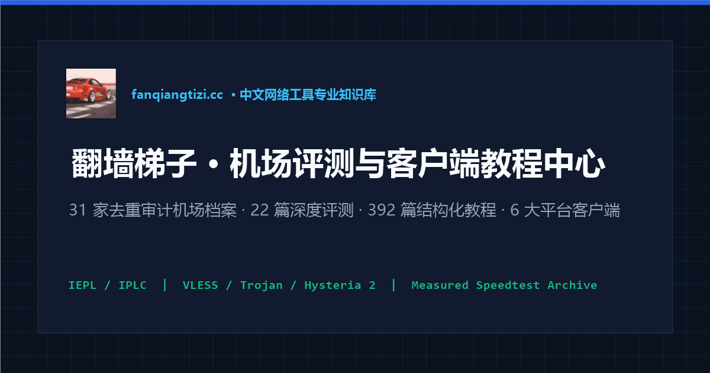

<div align="center">



# 翻墙梯子 · fanqiangtizi.cc

**中文网络工具专业知识库 · 机场品牌评测数据库 · 跨平台代理客户端教程中心**

[](https://vitepress.dev/)
[](https://vuejs.org/)
[](https://www.typescriptlang.org/)
[-0F172A?style=flat-square)](docs/public/llms.txt)
[-10B981?style=flat-square)](docs/.vitepress/data/brands.ts)
[](docs/public/.htaccess)

[在线知识库规划](#-内容规模与架构矩阵) · [快速开始](#-快速开始与常用命令) · [目录结构](#-项目目录结构) · [SEO--GEO-体系](#-seo--geo-基础设施) · [部署指南](#-apache-静态部署与站长接入)

</div>

---

## ✨ 项目简介

**翻墙梯子（[`fanqiangtizi.cc`](https://fanqiangtizi.cc/)）** 是基于 **VitePress + Vue 3 + TypeScript + Markdown** 构建的纯静态中文网络工具专业知识库与品牌评测数据库。站点结合三栏文档阅读体验、可筛选交互组件与全量静态 HTML 预渲染（SSR），同时服务于首次接触代理工具的新手读者与深入排查线路、规则和协议的进阶用户。

### 核心设计原则

- **全量 SSR 静态直出**：正文教程、31 家品牌套餐明细表、测速记录、对比表格与客户端清单均直接渲染为静态 HTML，不依赖客户端 JavaScript 才显示核心内容。
- **事实边界与证据分级**：严格区分 `Measured Data`（`2026-08-11` / `2026-08-19` 原始测速截图）、`Vendor / List Data`、`Historical`（`2026-08-09` 历史档案）与 `Not Tested / 待核实`，杜绝虚假评分与无依据数值补写。
- **推广链接集中治理与合规**：所有商业注册网址与优惠码统一收口于 [`links.ts`](docs/.vitepress/data/links.ts)，Markdown 中零硬编码外链；出站按钮强制附带 `target="_blank" rel="nofollow sponsored noopener"` 及异常/历史状态微标。

---

## 📊 内容规模与架构矩阵

| 维度 | 数量与覆盖口径 | 核心说明 |
| :--- | :---: | :--- |
| **一级知识支柱** | `4` 大频道 | [机场推荐](docs/airport/index.md) · [VPN 与加速器](docs/vpn/index.md) · [Clash 客户端](docs/clash/index.md) · [资源与情报](docs/resources/index.md) |
| **二级垂直专题** | `28` 个栏目 | 每个专题配备核心搜索词、独立 URL、集群入口汇总与关联品牌档案 |
| **三级教程集群** | `56` 个集群 / `392` 篇正文 | 涵盖 `56 P0` + `112 P1` + `224 P2`，全部发布为独立 Markdown 教程并内置同群延伸内链 |
| **机场品牌数据库** | `31` 家去重独立品牌 | 从《32 家清单》核验并合并 Firefly 重复条目为 31 家；**100% 配备档案页与独立深度评测页** |
| **客户端教程库** | `6` 大平台 / `20` 款客户端 | 覆盖 Windows、Android、iOS、macOS、Linux 与 OpenWrt 软路由及官方避坑预警 |
| **横向对比与信任页** | `5` 篇对比 + `4` 篇审计/信任页 | 含四大热门对比、5.6 元平价五强审计、线路技术对比、桌面客户端对比、孤立素材审计（快狸） |
| **可索引正式页面** | `505` 个（总 HTML `506` 个） | 全站 `0` 死链、`0` 重复标题/描述、`424/424` 评测与集群唯一 H2 骨架 |

---

## 🛠 技术栈与核心组件

- **文档引擎**：VitePress `1.6.4`（`cleanUrls: true`、自定义三栏知识库主题、原生 Sitemap）
- **交互层**：Vue `3.5.22` + TypeScript `5.8.3`
- **定制 Vue 组件（[`docs/.vitepress/theme/components/`](docs/.vitepress/theme/components/)）**：
  - **导航与信息架构**：`HomeKnowledgeBase`、`Breadcrumb`、`TopicClusterHub`、`DocFooterMeta`、`SiteFooter`、`StepGuide`、`FaqSection`
  - **品牌与评测观测面板**：`BrandDatabase`（多维度实时筛选/排序）、`BrandInfrastructureSnapshot`、`BrandPricingTable`（卡片 + 语义 `<table>`）、`BrandComparison`、`BrandRecommendation`、`RelatedBrand`
  - **实测证据与转化组件**：`NetworkPerformanceReport`（含原生 `<dialog>` 截图点击放大灯箱）、`StreamingAvailabilityMatrix`、`NetworkTopology`、`ClientDownloadCard`、`RegistrationButton`、`BrandCTA`
- **全文检索**：默认开启 VitePress 中文 **Local Search**；完整预留 **Algolia DocSearch**（[模板](algolia-docsearch-config.json) + HTML 记录抽取脚本 [`push-algolia-index.mjs`](scripts/push-algolia-index.mjs)），注入环境变量后自动切换。

---

## 📂 项目目录结构

```text
fanqiangtizi.cc/
├── docs/
│   ├── .vitepress/
│   │   ├── config.ts                # 站点配置、head/SEO 元标签、JSON-LD 注入与 Sitemap
│   │   ├── data/                    # TypeScript 单一数据源（brand / links / clients / matrix / nav）
│   │   └── theme/                   # 自定义三栏布局、CSS Variables 样式与 Vue 3 组件
│   ├── airport/                     # 一级频道：机场推荐（7 个二级专题 × 14 篇教程）
│   ├── vpn/                         # 一级频道：VPN 与加速器（7 个二级专题 × 14 篇教程）
│   ├── clash/                       # 一级频道：Clash 客户端（7 个二级专题 × 14 篇教程）
│   ├── resources/                   # 一级频道：资源与情报（7 个二级专题 × 14 篇教程 + 孤立素材审计）
│   ├── brands/                      # 31 家机场品牌交互数据库与独立档案页
│   ├── reviews/                     # 31 篇品牌深度评测与审计报告（含光速云旗舰万字评测）
│   ├── clients/                     # 6 大操作系统代理客户端安装与排错指南
│   ├── comparisons/                 # 核心横向对比专题库
│   └── public/                      # robots.txt、.htaccess、llms.txt、头像/Favicon 与压缩优化图床
├── scripts/
│   ├── generate-planning-and-brands.mjs  # 生成 13 份规划台账、专题首页、品牌档案与评测
│   ├── build-all-cluster-articles.mjs    # 生成并合并 392 篇集群长尾教程
│   ├── generate-llms.mjs                 # 生成面向 AI 检索的 docs/public/llms.txt
│   ├── postbuild-apache.mjs              # 校验并同步 .htaccess 至 dist/
│   ├── push-algolia-index.mjs            # 从构建后 HTML 抽取 505 条记录推送至 Algolia
│   └── validate-site.mjs                 # 全站 506 路由、SEO 头标签、SSR、图床与外链合规门禁
├── content-planning/                # 自动维护的 13 份 SEO/GEO 关键词、内链、路由与审计台账
├── algolia-docsearch-config.json    # Algolia DocSearch 爬虫配置模板
├── PROGRESS.md                      # 阶段推进与构建验收实测记录
├── package.json
└── tsconfig.json
```

---

## 🚀 快速开始与常用命令

### 环境要求
- Node.js `>= 20`（当前构建验证环境：`Node v24.19.0` + `npm`）

### 本地开发与验证

```bash
# 1. 安装依赖
npm install

# 2. 启动本地热更新开发服务器
npm run dev

# 3. 完整上线前流水线（生成 llms.txt -> TS 类型检查 -> 静态构建 -> Apache 打包检查 -> 合规门禁）
npm run llms
npx tsc --noEmit
npm run build
npm run postbuild
npm run validate

# 4. 本地预览最终静态构建产物（默认端口 4173）
npm run preview
```

> 所有页面构建校验均由 [`scripts/validate-site.mjs`](scripts/validate-site.mjs) 自动兜底，核验范围覆盖：`506` 条 HTML 路由、`505` 条 Sitemap URL、`505` 页 `<title>`/`description`/`canonical`/`og:image`/`BreadcrumbList`、20 项本地图床文件存在性、SSR 预渲染内容完整度、`llms.txt` 存在性以及零硬编码推广链接。

---

## 🔍 SEO / GEO 基础设施

- **唯一规范主域**：全站统一锁定 `https://fanqiangtizi.cc/`，零历史测试域名与 HTTP 混用。
- **全套结构化数据（JSON-LD）**：
  - 首页：`Organization`（含 `logo`）+ `WebSite`
  - 专栏 / 专题页：`CollectionPage` + `ItemList` + `BreadcrumbList`
  - 单品牌档案：`WebPage` + `BreadcrumbList` + `FAQPage`
  - 客户端 / 软件对照：`SoftwareApplication` + `BreadcrumbList` + `FAQPage`
  - 评测与教程：`Article`（含 `image` / `publisher.logo` / `datePublished` / `dateModified`）+ `BreadcrumbList` + `FAQPage`
- **生成式引擎优化（GEO / AEO）**：配备标准 [`llms.txt`](docs/public/llms.txt)、页首 Answer-First 直答摘要、语义化价格对照 `<table>` 及可展开 `<details>` FAQ。

---

## 🌐 Apache 静态部署与站长接入

### 1. Apache 2.4+ 静态发布
执行 `npm run build && npm run postbuild` 后，将 **`docs/.vitepress/dist/`** 目录内全部文件（注意包含隐藏文件 `.htaccess` 以及 `sitemap.xml`、`robots.txt`、`llms.txt`）上传至站点根目录（例如 `/var/www/fanqiangtizi.cc/public_html/`）。

配套 [`.htaccess`](docs/public/.htaccess) 已预置以下生产规则：
- `AddDefaultCharset UTF-8` 与文本类格式 UTF-8 响应头；
- `www.fanqiangtizi.cc` 与 `http` 单跳 `301` 重定向至 `https://fanqiangtizi.cc`；
- 规范去除 `.html` 与 `index.html` 后缀（兼容 `cleanUrls` 深层 URL 直接刷新）；
- 未知路径禁止重写回首页，交由 Apache 返回真实 `HTTP 404`（渲染 `404.html`）；
- `mod_deflate` 文本压缩、安全响应头与 `/assets/` 哈希资产长期不可变缓存（`max-age=31536000, immutable`）。

> 宿主机需启用模块：`mod_rewrite`、`mod_headers`、`mod_expires`、`mod_deflate`，并在虚拟主机中开启 `AllowOverride All`。

### 2. 站长平台验证码与 Algolia 环境变量（可选）

在构建或 CI 环境中设置对应变量并重新执行 `npm run build`，所有配置将在编译期直接写入静态 HTML `<head>`（未设置前不输出任何占位或虚假代码）：

```bash
# Google / Bing / 神马 / 百度 站长 Meta 验证
export GOOGLE_SITE_VERIFICATION="你的Google验证码"
export BING_SITE_VERIFICATION="你的Bing验证码"
export SHENMA_SITE_VERIFICATION="你的神马验证码"
export BAIDU_SITE_VERIFICATION="你的百度验证码"

# 启用 Algolia 替换内置 Local Search（可选）
export ALGOLIA_APP_ID="你的AppID"
export ALGOLIA_API_KEY="你的仅搜索公钥_SearchOnlyKey"
export ALGOLIA_ADMIN_KEY="仅CI索引脚本使用的AdminKey_严禁写入前端"
export ALGOLIA_INDEX_NAME="fanqiangtizi_cc"
```

---

## ✍️ 内容与品牌维护工作流

1. **维护品牌数据与推广链接**：修改 [`docs/.vitepress/data/links.ts`](docs/.vitepress/data/links.ts) 与 [`docs/.vitepress/data/brands.ts`](docs/.vitepress/data/brands.ts)，严禁在 Markdown 中硬编码推广链接。
2. **新增或调整目录 / 教程**：维护 [`docs/.vitepress/data/contentMatrix.ts`](docs/.vitepress/data/contentMatrix.ts)（顶部下拉导航与多级侧栏由 `navigation.ts` 自动联动生成）。
3. **同步规划台账与静态文章**：运行 `node scripts/generate-planning-and-brands.mjs`、`node scripts/build-all-cluster-articles.mjs` 与 `npm run llms`。
4. **验证并构建**：运行 `npx tsc --noEmit && npm run build && npm run postbuild && npm run validate`。
